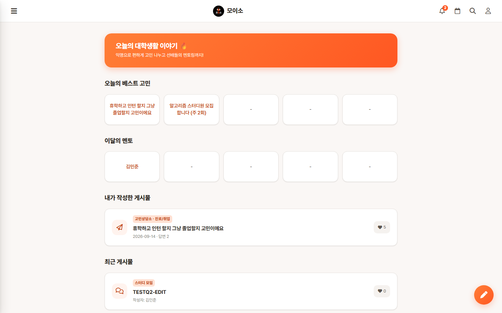
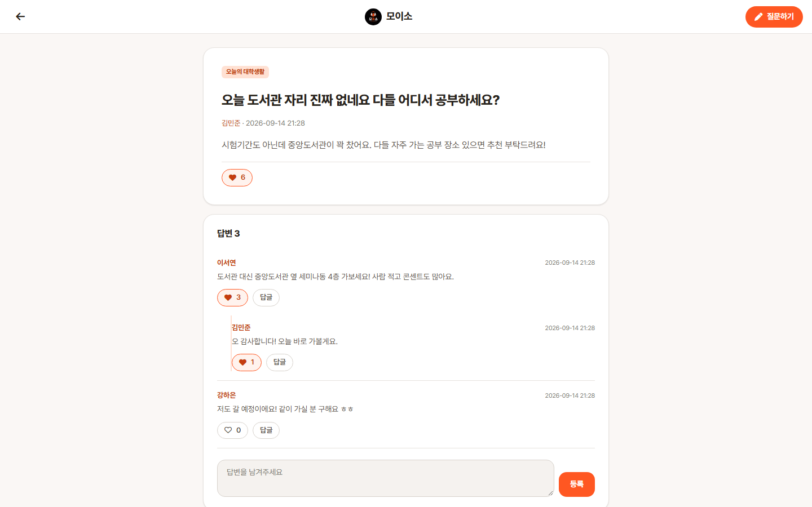
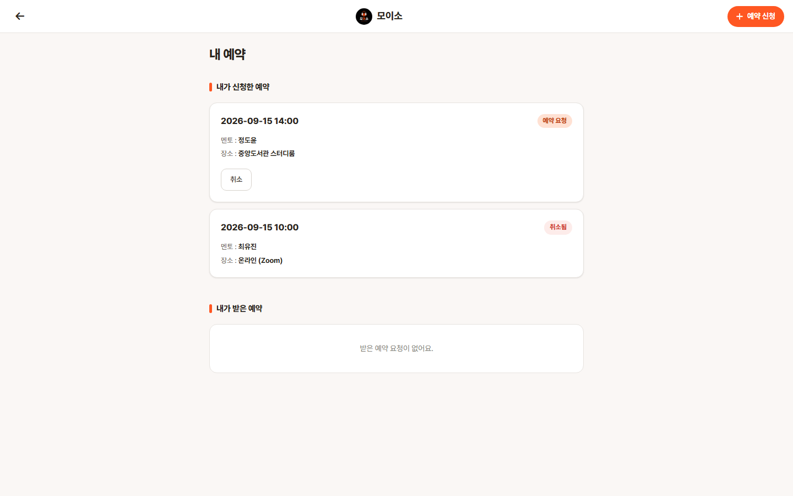
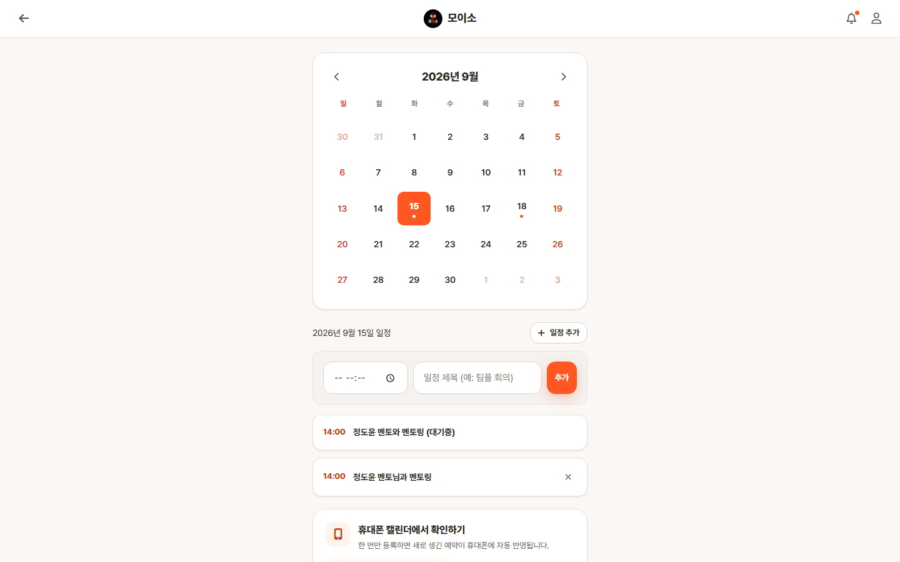
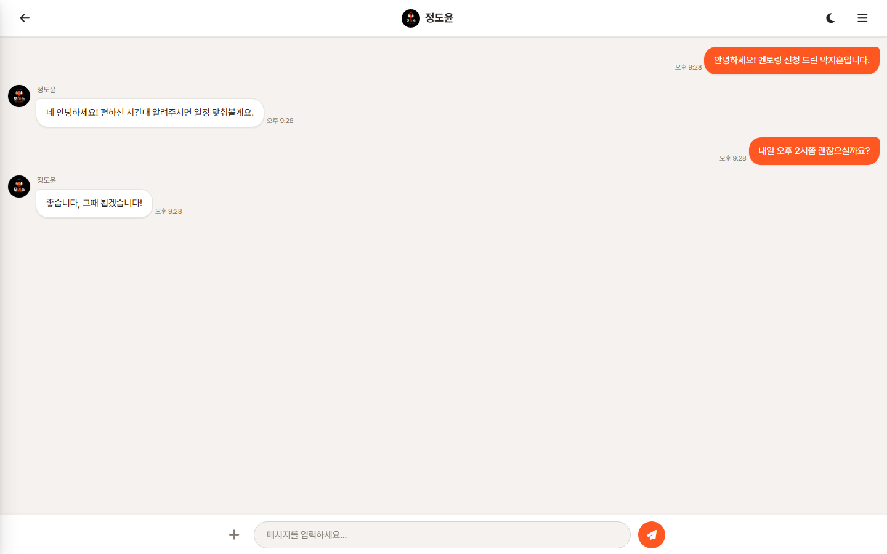

# 모이소 (Moiso)

대학생을 위한 Q&A 기반 멘토링 플랫폼입니다. 질문을 올린 사람은 멘티, 답변을 다는 사람은 멘토가 되는
구조로, 질문/답변에서 시작해 1:1 채팅 → 멘토링 예약 → 후기 작성까지 하나의 흐름으로 이어집니다.

Spring Boot 4 + Thymeleaf 서버 사이드 렌더링, 세션 기반 인증으로 구현한 풀스택 웹 애플리케이션입니다.

## 스크린샷

| 메인 (베스트 고민 / 이달의 멘토 랭킹) | 질문 상세 (답변 트리 + 좋아요) |
| --- | --- |
|  |  |

| 멘토링 예약 | 캘린더 (예약 연동 + iCal 구독) | 1:1 채팅 |
| --- | --- | --- |
|  |  |  |

## 주요 기능

| 영역 | 설명 |
| --- | --- |
| 회원 | 회원가입/로그인(세션), 프로필 수정, 비밀번호 변경, 공개 프로필 조회 |
| 비밀번호 찾기 | 이메일 찾기 + 메일로 재설정 토큰 발송(Naver SMTP) 후 재설정 |
| 질문/답변 | 9개 카테고리 게시판, 이미지 첨부, 대댓글형 답변 트리, 수정/삭제 |
| 좋아요 | 질문·답변 좋아요, 집계 기반 "오늘의 베스트 고민" / "이달의 멘토" 랭킹 |
| 멘토링 예약 | 예약 요청 → 수락/거절/완료/취소 상태 전이 관리 |
| 캘린더 | 개인 일정 등록·삭제, 예약 일정 연동, 토큰 기반 iCal 피드 구독 |
| 채팅 | 1:1 채팅방 생성, 메시지 송수신(폴링 방식) |
| 친구 | 친구 요청/수락/거절/삭제 |
| 알림 | 답변·좋아요·채팅·예약·친구 이벤트 알림, 읽음 처리 |
| 후기 | 완료된 예약 또는 받은 답변에 대한 별점 + 후기 작성 |
| 장소 | 멘토링 장소 등록/수정/삭제 및 주소 변환 |
| 검색 | 질문 검색 + 인기 검색어 집계 |

## 기술 스택

- **Java 17**, **Spring Boot 4.1.1** (Gradle, WAR 패키징)
- Spring MVC + **Thymeleaf** (서버 사이드 렌더링)
- **Spring Data JPA** / Hibernate, **MySQL 8**
- Spring Boot Validation, Spring Boot Mail, `spring-security-crypto`(BCrypt)
- Lombok
- 프론트엔드: 순수 HTML/CSS/JS (빌드 도구 없음), Font Awesome 아이콘

## 프로젝트 구조

```
src/main/java/com/example/bootcampproject/
├── config/        # WebConfig, 로그인 체크 인터셉터, CSRF 인터셉터/Advice, PasswordEncoder
├── controller/    # 12개 컨트롤러 (User, Question, Answer, Appointment, Calendar, Chat,
│                  #   Friend, Like, Location, Notification, PasswordReset, Review)
├── service/       # 14개 서비스 (비즈니스 로직)
├── repository/    # 16개 Spring Data JPA 리포지토리
├── entity/        # 16개 엔티티 + enums/ (카테고리, 예약상태, 알림타입, 친구상태, 목적)
├── dto/
│   ├── request/   # 18개 요청 DTO (Bean Validation)
│   └── response/  # 16개 응답 DTO (대부분 record)
├── exception/     # 도메인 예외 + GlobalExceptionHandler
├── HomeController.java     # 정적 페이지 라우팅 + 메인 화면 조립
└── DevDataSeeder.java      # 로컬 테스트용 더미 데이터 시딩

src/main/resources/
├── templates/     # Thymeleaf 템플릿 (23개)
├── static/css/    # 페이지별 CSS (20개) + base.css / layout.css 공통 디자인 시스템
├── static/js/     # 페이지별 스크립트 (14개) + csrf.js
└── application.yaml
```

## 보안 처리

- 비밀번호는 BCrypt로 해싱하여 저장
- `LoginCheckInterceptor`가 **기본 차단(default-deny)** 방식으로 동작. 비로그인 접근이 필요한
  핸들러에만 `@NoLoginRequired`를 붙이는 방식이라, 새 컨트롤러를 추가해도 인증 누락이 생기지 않습니다.
- `CsrfInterceptor` + `CsrfTokenAdvice`가 모든 상태 변경 요청(POST)에 CSRF 토큰을 검증/자동 주입
- DB 비밀번호·메일 계정은 코드에 하드코딩하지 않고 환경변수 또는 git 추적에서 제외된
  `.env.properties`로 주입

## 트러블슈팅

### 1. 로그인 체크를 컨트롤러마다 반복하다가 누락 위험이 생김

- **문제**: 컨트롤러가 늘어나면서 "`loginUser == null`이면 `/login`으로 리다이렉트" 체크가 메서드마다
  복사-붙여넣기로 흩어져 있었습니다. 새 엔드포인트를 추가할 때 이 한 줄을 깜빡하면 비로그인 상태로도
  접근 가능한 구멍이 그대로 배포될 위험이 있었습니다.
- **원인**: 인증 체크가 "옵트인(opt-in)" 구조였던 것 — 기본값이 "체크 안 함"이라 추가해야만 보호되는 방식.
- **해결**: `LoginCheckInterceptor`로 **기본 차단(default-deny)** 구조로 뒤집었습니다. 모든 핸들러를
  가로채 세션에 로그인 사용자가 없으면 차단하고, 비로그인 접근이 필요한 소수의 핸들러(로그인/회원가입/검색
  등)에만 `@NoLoginRequired` 어노테이션을 붙이는 화이트리스트 방식으로 전환했습니다. 이제 새 컨트롤러를
  추가해도 "보호를 깜빡하는" 실수 자체가 구조적으로 불가능합니다. AJAX(`@ResponseBody`) 엔드포인트는
  리다이렉트 대신 401을 반환하도록 분기했습니다.

### 2. 세션 쿠키 기반 인증에 CSRF 방어가 없었음

- **문제**: 세션 쿠키만으로 로그인을 유지하는 구조라, 외부 사이트가 로그인된 사용자의 브라우저를 통해
  삭제/수정 같은 상태 변경 요청을 위조해 보낼 수 있는 CSRF 취약점이 있었습니다.
- **원인**: Spring Security를 쓰지 않고 직접 세션 인증을 구현하면서 CSRF 토큰 발급/검증을 함께
  구현하지 않았습니다.
- **해결**: 매 세션마다 토큰을 발급하는 `CsrfTokenAdvice`와, `GET/HEAD/OPTIONS/TRACE`를 제외한 모든
  요청에서 세션 토큰과 요청 토큰(`_csrf` 히든 필드 또는 `X-CSRF-TOKEN` 헤더)을 비교하는
  `CsrfInterceptor`를 추가했습니다. `csrf.js`가 모든 `method="post"` 폼과 `fetch` 호출에 토큰을
  자동으로 주입하므로, 새 폼을 추가할 때 CSRF 처리를 또 빠뜨릴 걱정이 없습니다. (로그인 체크 때와 같은
  이유로, 호출부마다 고치는 대신 인터셉터 한 곳에서 기본 차단하는 쪽을 택했습니다.)

### 3. Naver SMTP 인증 실패 — "Authentication failed"

- **문제**: 비밀번호 재설정 메일 발송 시 Naver SMTP(`smtp.naver.com`)에서 계속 인증 실패가 났습니다.
- **원인**: 네이버 메일은 SMTP 인증 아이디(`username`)로 `user@naver.com` 전체 형식이 아니라
  **로컬파트(`user`)만** 받습니다. 하지만 메일 헤더의 `From` 주소는 전체 이메일 형식이어야 해서,
  하나의 값으로는 두 용도를 다 만족시킬 수 없었습니다.
- **해결**: `MAIL_USERNAME`(SMTP 인증용 로컬파트)과 `app.mail-from`(헤더 `From` 주소)을 분리했습니다.
  메일 발송 실패는 예외로 잡아 `PasswordResetService`가 사용자에게 "메일 발송에 실패했다"는 안내만
  내려주고, 500 에러로 터지지 않게 처리했습니다.

### 4. `setx`로 설정한 환경변수가 이미 실행 중인 프로세스에 반영되지 않음

- **문제**: `setx DB_PASSWORD=...`로 환경변수를 설정했는데도 IDE에서 이미 띄워둔 Gradle 데몬/애플리케이션은
  계속 빈 비밀번호로 DB 연결을 시도했습니다.
- **원인**: `setx`는 레지스트리에만 값을 쓰고, 이미 실행 중인 프로세스의 환경변수 블록에는 소급 적용되지
  않습니다. 새 값을 보려면 그 프로세스를 포함한 상위 프로세스(터미널/IDE)를 통째로 재시작해야 했습니다.
- **해결**: 매번 IDE를 재시작하는 대신, `spring.config.import: optional:file:.env.properties`로 로컬
  전용 비밀값 파일을 불러오도록 바꿨습니다. 이 파일은 `.gitignore`에 올려 커밋되지 않고, 파일이 없는
  CI나 다른 PC에서는 `optional:` 덕분에 조용히 넘어가고 OS 환경변수(`DB_PASSWORD` 등)만으로 동작합니다.

### 5. 컨트롤러마다 성공 피드백(flash message) 유무가 제각각이었음

- **문제**: 예약/캘린더/친구/장소/후기 등록은 전부 "~했습니다" 플래시 메시지를 보여주는데, 정작 핵심
  기능인 질문·답변 작성/수정에는 그 메시지가 없었습니다. 사용자 입장에서는 저장이 됐는지 알 길이
  화면 전환만으로 파악해야 했습니다.
- **원인**: 기능을 하나씩 추가하면서 컨트롤러마다 스타일이 자리를 잡았고, 전체를 가로지르는 일관성
  점검 없이 넘어갔습니다.
- **해결**: 전 컨트롤러의 생성/수정/삭제 핸들러를 훑어 플래시 메시지 유무를 전수 비교한 뒤,
  `QuestionController`/`AnswerController`에 빠져 있던 `redirectAttributes.addFlashAttribute("message", ...)`
  호출을 추가했습니다("질문이 등록되었습니다.", "답변을 추가했습니다." 등). 스크린샷 대신 실제 HTTP
  세션으로 등록→리다이렉트→플래시 메시지 노출까지 curl로 재현해 검증했습니다.

## 실행 방법

### 1. 사전 준비

- JDK 17 이상
- MySQL 8 이상

### 2. 데이터베이스 생성

```sql
CREATE DATABASE bootcampproject
  DEFAULT CHARACTER SET utf8mb4
  DEFAULT COLLATE utf8mb4_unicode_ci;
```

테이블은 `spring.jpa.hibernate.ddl-auto=update` 설정으로 첫 실행 시 자동 생성됩니다.

### 3. 환경변수 설정

프로젝트 루트에 `.env.properties` 파일을 만듭니다. (이 파일은 `.gitignore`에 포함되어 커밋되지 않습니다.)

```properties
DB_PASSWORD=your_mysql_password

# 로컬 테스트용 더미 데이터 시딩 (users 테이블이 비어있을 때 1회만 동작)
APP_SEED_ENABLED=true
```

OS 환경변수로 넣어도 동일하게 동작하며, 아래 값들은 생략 시 기본값이 쓰입니다.

| 변수 | 기본값 | 설명 |
| --- | --- | --- |
| `DB_URL` | `jdbc:mysql://localhost:3306/bootcampproject?...` | JDBC 접속 URL |
| `DB_USERNAME` | `root` | DB 계정 |
| `DB_PASSWORD` | *(필수)* | DB 비밀번호 |
| `MAIL_USERNAME` | *(빈 값)* | Naver SMTP 아이디 (**@naver.com 없이 아이디만**) |
| `MAIL_PASSWORD` | *(빈 값)* | Naver 메일 **앱 비밀번호** (로그인 비밀번호 아님) |
| `MAIL_FROM` | `noreply@moiso.local` | 메일 From 헤더 주소 |
| `APP_SEED_ENABLED` | `false` | 더미 데이터 시딩 여부 |

메일 설정이 비어 있어도 앱은 정상 실행되며, 비밀번호 재설정 메일 발송 시점에만 실패하고
사용자에게 안내 메시지가 표시됩니다.

### 4. 실행

```bash
./gradlew bootRun
```

브라우저에서 http://localhost:8080 으로 접속합니다.

`APP_SEED_ENABLED=true`로 시딩한 경우, 더미 계정의 비밀번호는 모두 `test1234!` 입니다.

### 5. 빌드 / 테스트

```bash
./gradlew build    # WAR 생성 (build/libs)
./gradlew test     # 리포지토리 / 서비스 테스트 실행
```

> 참고: 테스트는 별도 테스트 DB가 아닌 개발 DB를 사용합니다. 실행 시 테스트 데이터가 쌓일 수 있습니다.

## 참고 사항

- 사용자가 업로드한 질문 첨부 이미지는 프로젝트 루트의 `uploads/` 디렉터리에 저장되며,
  소스가 아니므로 git 추적에서 제외되어 있습니다. (앱 실행 시 자동 생성)
- 채팅은 WebSocket이 아닌 주기적 폴링 방식으로 구현되어 있습니다.
